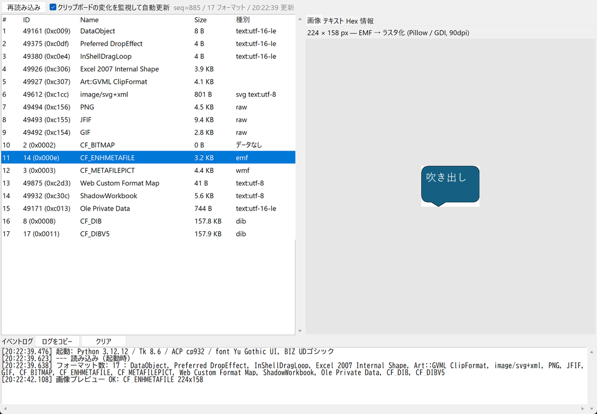
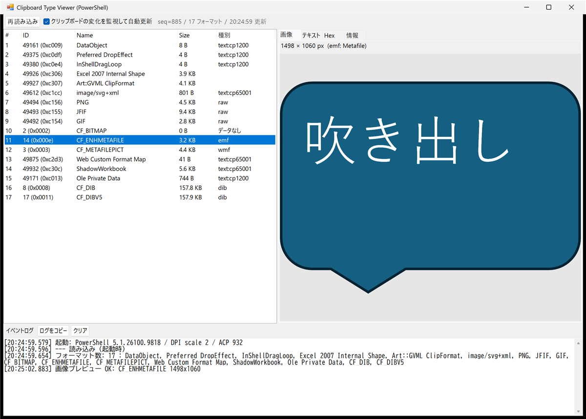
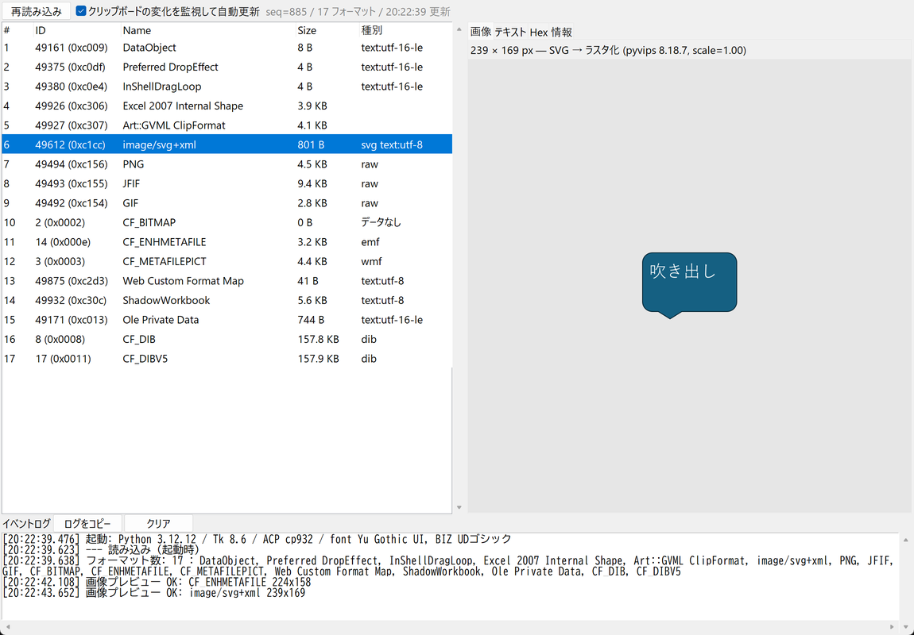
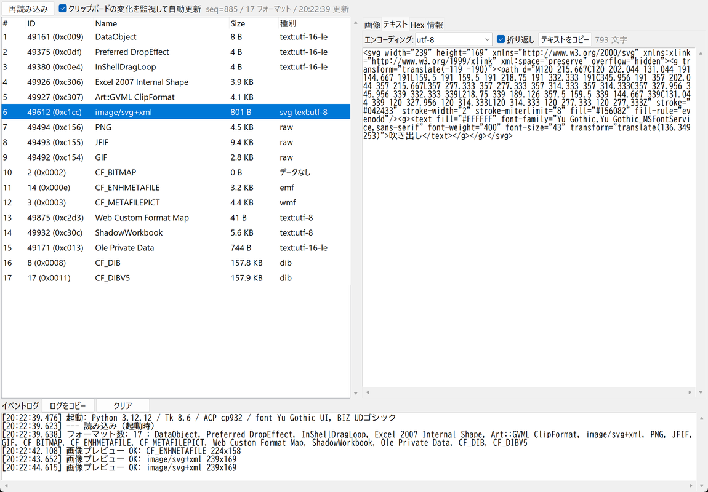
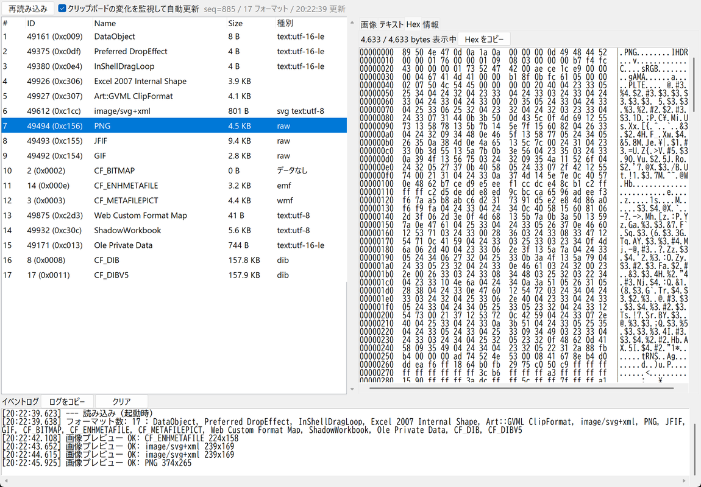
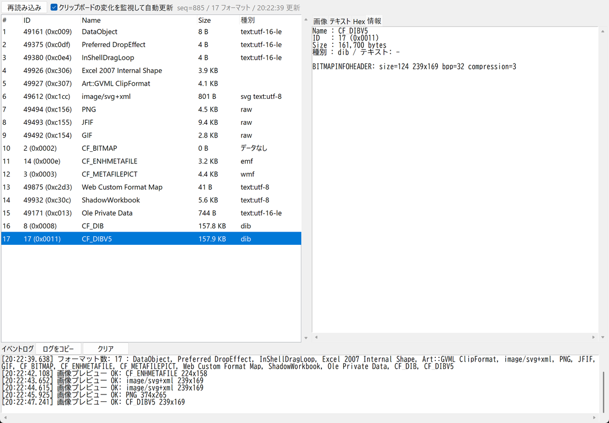
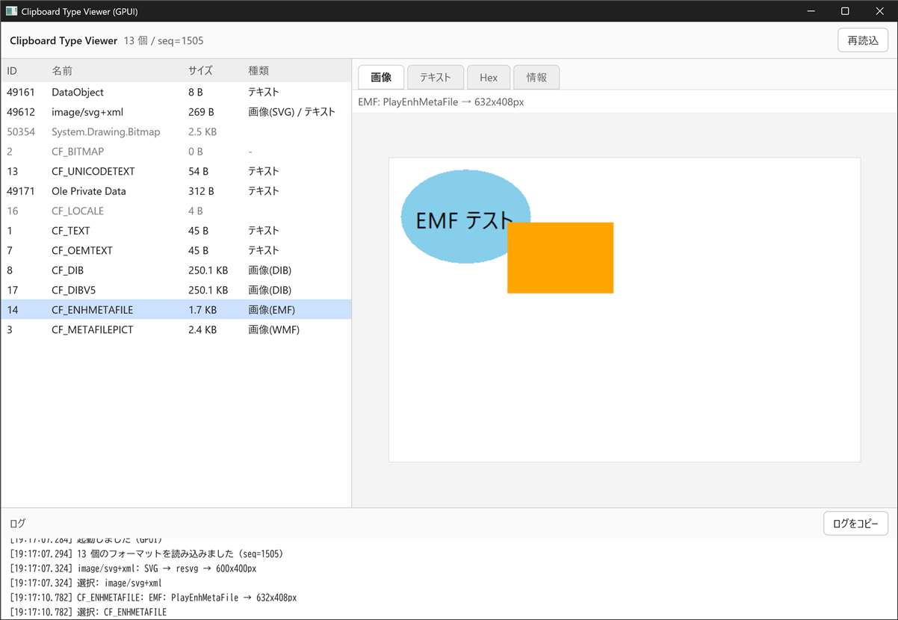
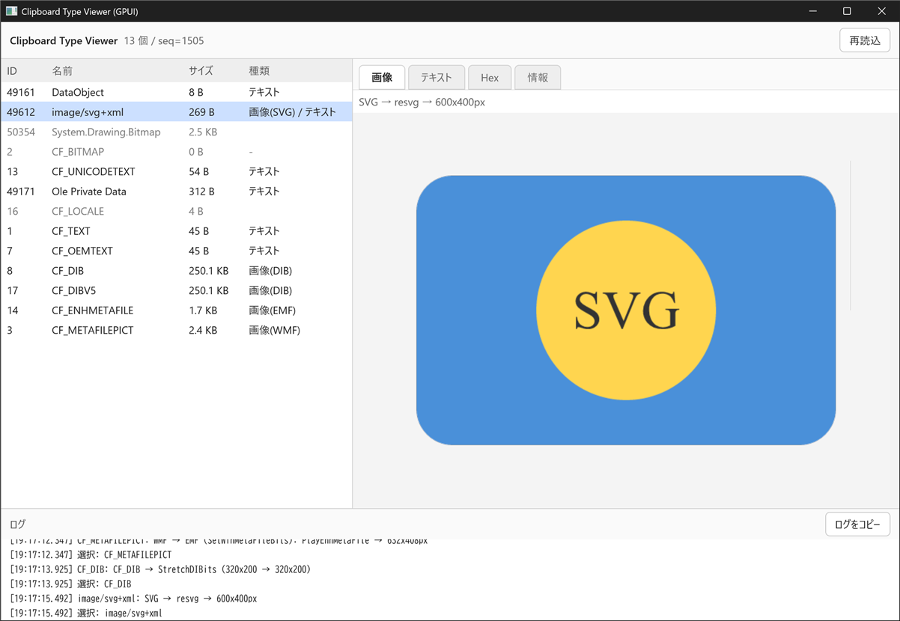
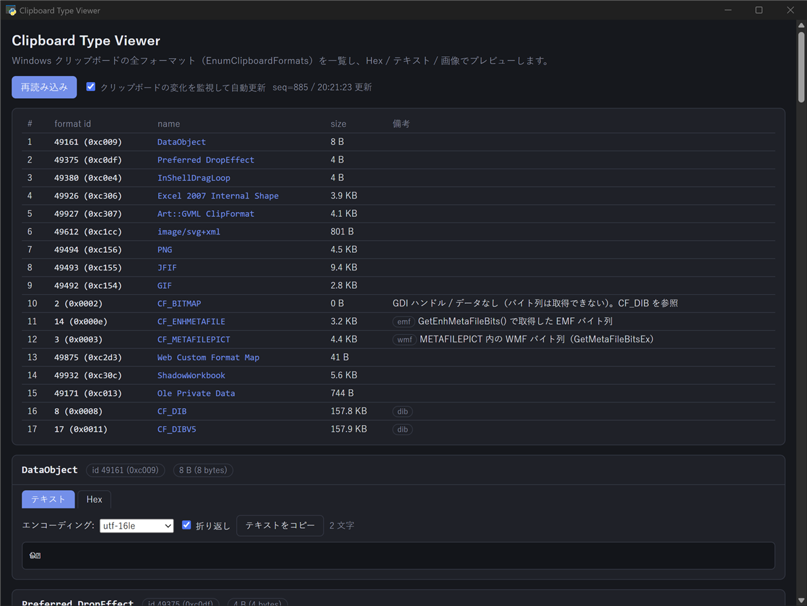
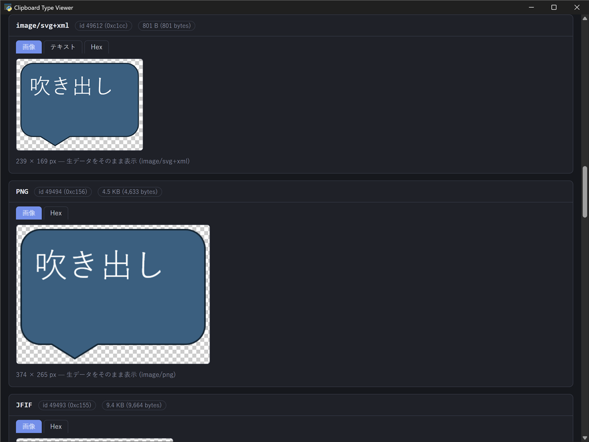

# cliptype — Clipboard Type Viewer

Windows のクリップボードに入っている**全フォーマット**（`CF_UNICODETEXT` / `HTML Format` / `CF_DIB` / `CF_ENHMETAFILE`(EMF) / アプリ独自形式 など）を一覧し、
各フォーマットの中身を **Hex ダンプ / テキスト / 画像** でプレビューする 1 ファイルの GUI ツール。

## 同じ機能を複数の方式で作ってみた

このツールは「シンプルな GUI ツールを作るなら、どの方式がよいか」を確かめる題材も兼ねている。
**同じ機能（全フォーマット一覧 + Hex / テキスト / 画像プレビュー + 自動更新 + ログ）を 4 つの方式で実装**し、
作りやすさ・できること・メモリ使用量を比べた。

1. **素の HTML（ブラウザ）** — 最初に作ったが、ブラウザは EMF などをページに渡さないため断念（[後述](#ブラウザhtmlではクリップボードの全フォーマットは見えない)）
2. **Python + pywebview** — HTML の画面をそのまま使い、クリップボードは Python（ctypes）で読む。見た目はよいが WebView2 で約 300 MB
3. **PowerShell + WinForms** — 追加インストール不要。約 85 MB
4. **Python + Tkinter** — 最軽量（`python.exe` 直接起動で約 20 MB）。SVG は pyvips で対応
5. **Rust + GPUI（rust-script）** — Zed エディタの GPU 描画 UI フレームワーク。1 ファイルの `.rs` を rust-script で実行。約 140 MB。初回ビルドに約 10 分

比較の結果は [メモリ比較](#メモリ比較実測) と [方式比較](#シンプルな-gui-ツールを作るときの方式比較) にまとめた。

## 機能の解説（スクリーンショット）

スクリーンショットは Excel の図形（吹き出し）をコピーした状態で撮影。Excel は 1 回のコピーで
EMF・WMF・SVG・PNG・JPEG・GIF・DIB・独自形式など **17 フォーマット**をクリップボードに入れている。

### 1. フォーマット一覧 + 画像プレビュー（EMF）

左にクリップボードの全フォーマット（ID・名前・サイズ・種別）、右に選択したフォーマットのプレビュー。
`CF_ENHMETAFILE`（EMF）はブラウザからは見えない形式だが、Win32 API で直接読んで画像化している。
`CF_BITMAP` のようにバイト列を持たない GDI ハンドル形式は「データなし」と表示する。

PowerShell 版は GDI+ の `Metafile` で EMF を**ベクターのまま**表示するので、拡大してもきれい。

### 2. SVG プレビュー

`image/svg+xml` は Tkinter 版では pyvips でラスタ化して表示（日本語テキストも描画される）。

### 3. テキスト表示

テキストとして読めるフォーマットは、フォーマットからエンコーディングを自動判定して表示
（`CF_UNICODETEXT`=UTF-16LE、`CF_TEXT`=cp932、`HTML Format`/SVG=UTF-8 など）。
プルダウンで別のエンコーディングに切り替えたり、テキストをコピーしたりできる。

### 4. Hex ダンプ

すべてのフォーマットでオフセット・16 進・ASCII を表示。大きいデータは先頭 64KB だけ表示し、「すべて表示」で全体を出す。
「Hex をコピー」で AI などに渡しやすい。

### 5. 情報

フォーマットごとの付加情報を表示。DIB のヘッダ（サイズ・bpp・圧縮）、EMF の物理サイズ、
`CF_HDROP`（エクスプローラーでのファイルコピー）のファイル一覧、`CF_LOCALE` の LCID など。

### 6. 自動更新とイベントログ

「クリップボードの変化を監視して自動更新」がオンなら、`GetClipboardSequenceNumber` を 1 秒ごとに見て、
別のアプリでコピーすると自動で読み直す（選んでいたフォーマットは維持）。
下部のイベントログには読み込みやプレビューの結果が残り、「ログをコピー」でまとめてコピーできる。
ツール内のコピー操作（ログ / テキスト / Hex）では自動更新しない。

### GPUI 版の画面

Rust + GPUI 版。レイアウトは Tkinter 版と同じく左に一覧、右にタブ（画像 / テキスト / Hex / 情報）、下にログ。
EMF / WMF / DIB は GDI（`PlayEnhMetaFile` / `StretchDIBits`）で 32bpp のビットマップに描いて表示し、SVG は resvg で描画する。
テキストと Hex は仮想スクロール（`uniform_list`）なので、大きいデータも全体をそのまま表示できる。

### pywebview 版の画面

pywebview 版は HTML で作った 1 ページ構成。上部に一覧表、その下にフォーマットごとのカード（画像 / テキスト / Hex タブ）が並ぶ。
SVG はブラウザがそのまま描画し、透過部分はチェック柄で表示する。

## ファイル

| ファイル | 方式 | 起動 |
|---|---|---|
| `cliptype_tk.py` | Python + Tkinter（+ Pillow, pyvips） | `uv run cliptype_tk.py` |
| `cliptype.ps1` | PowerShell 5.1 + WinForms（C# を `Add-Type`） | `powershell.exe -NoProfile -ExecutionPolicy Bypass -STA -File cliptype.ps1` |
| `cliptype.py` | Python + pywebview（WebView2 / HTML+JS） | `uv run cliptype.py` |
| `cliptype_gpui.rs` | Rust + GPUI（rust-script、依存はファイル先頭のコメント内の cargo ブロック） | `rust-script cliptype_gpui.rs` |
| `docs/*.png` | README 用スクリーンショット | — |

- Python 版はどちらも **Windows 側の uv**（`uv.exe`）で実行する。WSL の Python からは Windows クリップボードを読めない。
- GPUI 版は **Windows 側の rust-script** で実行する。必要なもの: Rust（MSVC 版、`winget install Rustlang.Rustup`）、Visual Studio Build Tools の C++ と Windows SDK（GPUI がシェーダーのコンパイルに `fxc.exe` を使う）、`cargo install rust-script`。
- どの版も `--dump`（PowerShell 版は `-Dump`）で GUI なしの一覧を標準出力に出せる。

## 機能（各版共通）

- `EnumClipboardFormats` で全フォーマットを列挙（ID・名前・サイズ・種別）
- **Hex**: 先頭 64KB（または 16KB）を表示、「すべて表示」で全体
- **テキスト**: フォーマットからエンコーディングを自動判定（`CF_UNICODETEXT`=UTF-16LE、`CF_TEXT`=ANSI(cp932)、`HTML Format`=UTF-8 など）。手動切替可
- **画像**: EMF / WMF / `CF_DIB`・`CF_DIBV5` / PNG・JPEG・GIF・BMP・TIFF などのシグネチャ判定
  - SVG: Tkinter 版は pyvips でラスタ化、pywebview 版はブラウザがそのまま描画、GPUI 版は resvg で描画、PowerShell 版は非対応（テキストのみ）
  - GPUI 版はテキストのエンコーディング手動切替・テキスト / Hex のコピーボタンは未実装（Hex は先頭 64KB に絞らず全体を表示）
- **情報**: `CF_HDROP` のファイル一覧、`CF_LOCALE` の LCID、DIB ヘッダ、EMF の物理サイズなど
- クリップボードの変化（`GetClipboardSequenceNumber`）を 1 秒ごとに監視して自動更新
- イベントログ + 「ログをコピー」ボタン

## 経緯で分かったこと

### ブラウザ（HTML）ではクリップボードの全フォーマットは見えない

最初は素の HTML アプリ（`navigator.clipboard.read()` / paste イベント）で作ったが、**EMF などは一覧に出てこない**。
ブラウザはセキュリティ上、Web 標準の MIME type（`text/plain`、`text/html`、`image/png`、`web ` 独自形式など）に
変換できるものしかページに渡さないため。`CF_DIB` は `image/png` に変換されるが、EMF は対応する型がなく捨てられる。
→ Win32 API（`OpenClipboard` / `GetClipboardData`）を直接呼べるネイティブ側の仕組みが必要。

### 実装上のハマりどころ

- **ctypes**: 64bit で `GetClipboardData` / `GlobalLock` などの `restype`/`argtypes` を指定しないとハンドルが切り詰められる
- **EMF / WMF** は HGLOBAL ではなく GDI ハンドルなので `GetEnhMetaFileBits` / `GetMetaFileBitsEx` でバイト列化する。`CF_BITMAP` / `CF_PALETTE` はバイト列を取れない
- **CF_DIB** は先頭に 14 バイトの BITMAPFILEHEADER を付けると BMP として読める（BI_BITFIELDS のマスク分のオフセットに注意）
- **高 DPI（200% 表示など）**: Tkinter はフォント（pt 指定）は自動で拡大されるが、ピクセル指定の幅（Treeview の列幅・ウィンドウサイズ）は拡大されない → `tk scaling` から倍率を出して掛ける
- **PowerShell 5.1** は BOM なし .ps1 を ANSI(cp932) として読む → **UTF-8 BOM 付き**で保存しないと日本語が壊れる。C# は C# 5 までの文法
- **ショートカットで `-WindowStyle Hidden`** を付けるとフォームが出ずに終了した → スクリプト内で `GetConsoleWindow` + `ShowWindow(SW_HIDE)` する `-HideConsole` を用意
- **uv run** は実行中ずっと **uv.exe（約 42 MB）が常駐**する（後述）
- **GPUI（0.2.2）**:
  - 初回ビルドは依存が多く約 10 分、rust-script のキャッシュ（`AppData\Local\rust-script`）は約 1.7 GB。2 回目以降はビルド済み exe（12 MB）を起動するだけ
  - リリースビルドでは HLSL シェーダーを Windows SDK の `fxc.exe` でコンパイルするので、Windows SDK が必須
  - `ImageFormat::Svg` で渡すと **赤と青が入れ替わる**（PNG などは RGBA→BGRA 変換しているが SVG だけ変換が抜けている）→ 自前で resvg を使い PNG にしてから渡す
  - クリップボードの SVG は**末尾に NUL（`\0`）が付いていることがある**。pyvips やブラウザは無視するが、resvg は `unknown token` で読み込みに失敗する → 取り除いてから渡す
  - `img()` を `size_full()` で置くだけだと、画像の大きさで枠が広がり下が切れる → 枠を `relative()`、`img` を `absolute()` にする
  - 一覧の行は `w_full()` を付けないと列が詰まる。長いリストは `uniform_list`（仮想スクロール）、行は等しい高さが前提なので長い行は 160 文字で折り返す
  - Rust 2024 では `gen` が予約語でフィールド名に使えない
  - 高 DPI は GPUI が自動で対応（Tkinter のような補正は不要）
- pyvips は `pyvips[binary]` にすると libvips 本体入りの wheel（Windows 用あり）が入り、`uv run` だけで動く。SVG 読み込みにも対応

## メモリ比較（実測）

条件: Windows 11 / クリップボードはテキスト（6 フォーマット）/ 起動 15 秒後 / Private（専有メモリ）。
子プロセス・ランチャーも含めた合計。

| 方式 | アプリ本体 | 付随プロセス | 合計 | プロセス数 |
|---|---:|---|---:|---:|
| Tkinter（`python.exe` 直接） | 18〜19 MB | conhost 1.5 MB（`pythonw.exe` なら不要） | **約 20 MB** | 1〜2 |
| Tkinter（`uv run`） | 19 MB | **uv.exe 42 MB** + venv ランチャー 1 MB | 約 62 MB | 3 |
| PowerShell + WinForms | 84 MB | conhost 1 MB | 約 85 MB | 2 |
| pywebview（`uv run`） | python 62 MB + **WebView2 200 MB** | uv.exe 42 MB + ランチャー 1 MB | 約 305 MB | 9 |
| Rust + GPUI（`rust-script`） | 137 MB（ワーキングセットは 63 MB） | rust-script.exe 1.6 MB | 約 139 MB | 2 |

- pywebview の WebView2 内訳: GPU プロセス 106 MB、browser 40 MB、renderer 32 MB、utility 等 22 MB
- 1280×853 の画像（DIB 4 MB）を表示すると Tkinter 版で +19 MB（別プロセスで計測）。同条件の実アプリ計測では Tkinter 46 MB / PowerShell 103 MB
- GPUI は DirectX 11 の描画用バッファ・フォントのアトラスなどで専有メモリが大きめ（実際に触っているワーキングセットは 63 MB）。画像を 4 種類表示した後は 155 MB
- pyvips は初回 SVG 表示時に読み込まれ +4 MB、800×600 の SVG 描画で +8 MB
- venv の `Scripts\python.exe` は本体を起動するだけのランチャー（0.8 MB）。uv のキャッシュ上の環境パス（`AppData\Local\uv\cache\environments-v2\...`）は依存を変えると変わるので、常用するなら固定の venv を作る方がよい

## シンプルな GUI ツールを作るときの方式比較

| 観点 | Python + Tkinter | PowerShell + WinForms | Python + pywebview | Rust + GPUI | （参考）素の HTML |
|---|---|---|---|---|---|
| ファイル数 | 1（PEP 723） | 1（.ps1） | 1（HTML を文字列で埋め込み） | 1（`.rs`、依存は先頭のコメントに書く） | 1 |
| 事前インストール | uv（または Python） | **不要**（Windows 標準） | uv（または Python）+ WebView2（Win10/11 は標準） | Rust + VS Build Tools（C++）+ Windows SDK + rust-script（合計数 GB） | 不要（ブラウザ + ローカルサーバー） |
| メモリ | **◎ 約 20 MB**（uv run だと +42 MB） | ○ 約 85 MB | △ 約 300 MB | ○ 約 140 MB | ブラウザのタブ 1 枚分 |
| Win32 API | ctypes で自由に呼べる | `Add-Type` の C# で自由に呼べる | ctypes（Python 側）で呼び JS に渡す | `extern "system"` で直接呼べる（型は自分で書く） | **不可**（ブラウザの許す範囲のみ） |
| 画面の作りやすさ・見た目 | △ 地味。レイアウトは pack/grid | △ 地味。Dock の順序に癖あり | **◎** HTML/CSS で自由。ダークモード等も楽 | ○ Tailwind 風のメソッドチェーン（`.flex().px_2()`）で書ける。見た目はモダン。部品（入力欄・ボタン等）は自作 | ◎ |
| 画像・SVG 表示 | Pillow で PNG 化して表示。SVG は pyvips 追加 | GDI+（EMF はベクターのまま表示可）。SVG 不可 | **◎** ブラウザがそのまま表示（SVG 含む） | ○ PNG/JPEG/GIF/BMP 等は `img()` で表示。SVG は resvg（色化けの回避が必要） | ◎ |
| 大量テキスト表示 | ○ Text ウィジェット | ○ TextBox | ○ | **◎** `uniform_list` の仮想スクロールで巨大データも軽い | ○ |
| 起動の手軽さ | `uv run` 1 行。コンソール窓を消すなら `pythonw.exe` | ショートカットで直接起動。ExecutionPolicy・BOM に注意 | `uv run` 1 行（初回は依存 DL あり） | `rust-script` 1 行。**初回ビルド約 10 分**、以降は即起動 | サーバー起動 + ブラウザで開く |
| 配布 | uv があれば .py を渡すだけ | .ps1 を渡すだけ（社内 PC でも動きやすい） | uv があれば .py を渡すだけ | ビルド済み exe（12 MB）1 個を渡せば動く。ソースで渡すと相手にも Rust 環境が要る | HTML を渡すだけ |
| 向いている用途 | **常駐・軽さ重視**の小物ツール | **追加インストール不可**の環境、Windows 管理系 | **見た目・表現力重視**、HTML の資産を流用したい | exe 1 個で配りたい、GPU 描画で大量データを滑らかに見たい | OS に触らない純 Web の道具 |

### 選び方の目安

1. **まずは Python + Tkinter**: 1 ファイル・最軽量・Win32 も ctypes で触れる。常用するなら `uv run` ではなく venv の `pythonw.exe` を直接起動して uv.exe の 42 MB とコンソール窓をなくす。
2. **何もインストールできない PC なら PowerShell + WinForms**: Windows 標準だけで動く。BOM 付き UTF-8、C# 5 文法、Dock の順序（Fill は最後に `BringToFront()`）に注意。
3. **UI の表現力が欲しいなら pywebview**: HTML/CSS/JS がそのまま使え、SVG なども表示できるが、WebView2 の分で数百 MB 使う。必要なときだけ起動する使い方向け。
4. **exe 1 個で配りたい・大量データを滑らかに見たいなら Rust + GPUI**: ビルド環境の用意（数 GB）と初回ビルド約 10 分が必要。GPUI は 0.x でドキュメントが少なく、ソースや examples を読みながら書くことになる。
5. **OS の機能（クリップボードの全形式、ファイル、レジストリ等）が要るなら素の HTML は不可**。

### 未検証の候補（参考）

- **C# 1 ファイル（.NET 10 の `dotnet run app.cs`）+ WinForms/WebView2**: 1 ファイルで exe 化もしやすい。この PC は .NET SDK 8 のみのため未試行（.NET 8 だと .csproj が必要で 2 ファイル）
- **Electron / Tauri**: ファイル数・ビルド構成が大きく「1 ファイルの小物」には不向き
